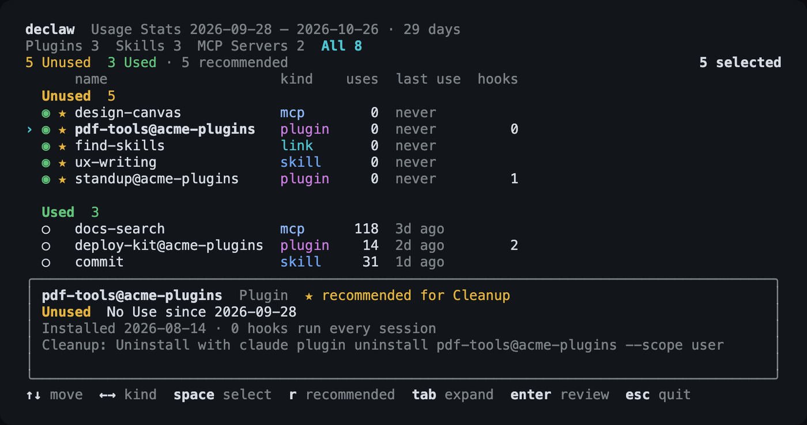

<p align="center"></p>

<h1 align="center">declaw</h1>

<p align="center">See which Claude Code plugins, skills, and MCP servers you actually use.<br>Remove the rest, with a way back for each.</p>

```sh
npx @sht02048/declaw
```



Requires Node 22 or later on macOS or Linux. Early development.

## Commands

```sh
npx @sht02048/declaw                # pick what to remove
npx @sht02048/declaw --dry-run      # the same, but stop before removing
npx @sht02048/declaw stats          # print Usage Stats as a table
npx @sht02048/declaw stats --json   # print them as JSON
```

## Every removal has a way back

Nothing is removed until you confirm. declaw uses Claude Code's own commands and never edits its config file.

| Installation | What happens | Undo |
|---|---|---|
| Plugin | `claude plugin uninstall <plugin> --scope user` | `claude plugin install <plugin> --scope user` |
| Standalone Skill | its folder moves to the system trash | restore it from the trash |
| Linked Skill | the link is removed; its target is kept | recreate the link with `ln -s` |
| Standalone MCP Server | its registration is backed up, then `claude mcp remove <name> --scope user` | `claude mcp add-json <name> "$(cat <backup file>)" --scope user` |
| Synced Skill | listed with `·`, never removed | nothing to undo |

## How it counts

A Use is a skill, slash command, subagent, or MCP tool call in your transcripts. Hooks never count. Everything runs on your machine, and an MCP server's URL and tokens are never shown. [How declaw works](docs/how-it-works.md)

## License

[MIT](LICENSE)
